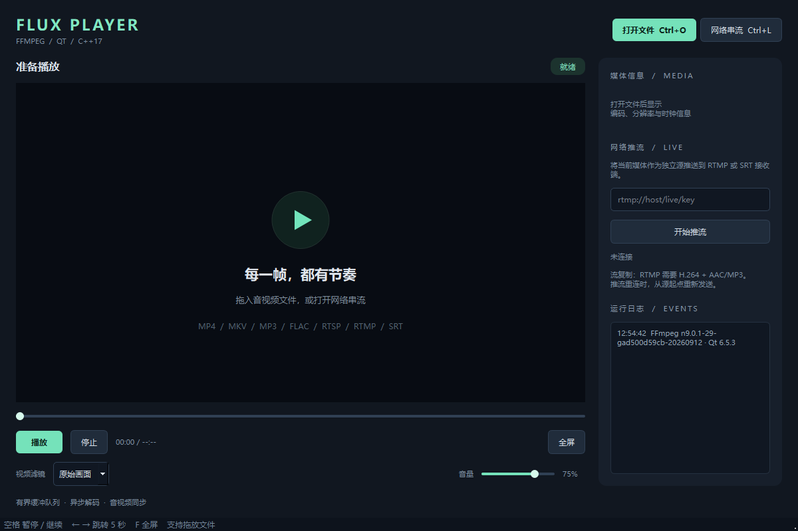
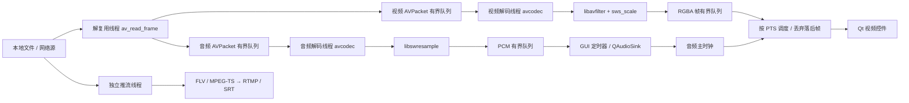

# Flux Player — FFmpeg + Qt 多媒体播放系统

可编译的 C++17 桌面播放器。播放链路直接使用 FFmpeg 库，Qt Widgets 提供界面，QAudioSink 播放解码后的 PCM。代码包含本地/网络播放、音视频同步、视频滤镜、网络重连以及独立的 RTMP/SRT 流复制推流。

本工作区已生成 Windows 运行包：双击根目录 `Run-Player.cmd`，或直接运行 `dist/FluxPlayer/FluxPlayer.exe`。移动运行包时，请保留整个 `dist/FluxPlayer` 文件夹中的 DLL 和插件子目录。仅拿到源码时，请按下方步骤构建。



## 功能与操作

| 功能 | 实现 |
| --- | --- |
| 本地媒体 | MP4、MKV、MOV、AVI、FLV、TS、MP3、WAV、FLAC 等，取决于 FFmpeg 编解码器 |
| 网络媒体 | HTTP(S)、RTSP、RTMP、UDP、TCP、SRT，取决于 FFmpeg 协议构建配置 |
| 播放控制 | 播放/暂停、停止、进度跳转、音量、全屏、拖放文件、文件播完后重播 |
| 同步 | 音频主时钟 + 视频 PTS 调度；落后视频帧丢弃；无声卡/纯视频时使用单调时钟 |
| 视频处理 | libavfilter 实现黑白、水平镜像、鲜艳、边缘检测；sws_scale 转换为 RGBA |
| 音频处理 | libswresample 重采样、通道混合、采样格式转换；适配默认输出设备 |
| 网络恢复 | 工作线程打开/探测；I/O 超时与取消回调；最多 5 次指数退避播放重连 |
| 推流 | 独立工作线程，RTMP/RTMPS → FLV，SRT → MPEG-TS；实时节奏发送、失败重试 |
| 可观测性 | 编码/分辨率、视频/音频缓冲、压缩包占用、丢帧统计、运行日志 |

快捷键：`Ctrl+O` 文件，`Ctrl+L` 网络地址，`Space` 暂停/继续，`← / →` 跳转 5 秒，`F` 全屏，`Esc` 退出全屏。双击画面也可切换全屏。

## 依赖

- CMake 3.20+，C++17 编译器。
- Qt **6.4+** 的 Widgets、Multimedia 开发组件。
- FFmpeg **5.1+** 共享开发库：`avformat`、`avcodec`、`avutil`、`swscale`、`swresample`、`avfilter`。
- 完整回归测试另外使用 Python 3、`ffmpeg` 和 `ffprobe` 命令行工具。
- Windows 的 Qt、编译器、FFmpeg SDK 必须都是 x64。MSVC Qt 使用 MSVC 编译器；MinGW Qt 使用匹配的 MinGW 工具链，不能混用 Qt ABI。
- SRT 需要 FFmpeg 构建启用 `libsrt`；HTTPS/RTMPS 需要对应 TLS 支持。`ffmpeg -protocols` 可查看命令行版本的能力，应用实际以链接的 FFmpeg DLL 为准。

## Windows 构建

安装 Visual Studio 2022 的“使用 C++ 的桌面开发”、Qt MSVC x64 包和 FFmpeg **shared SDK**。FFmpeg 目录应同时包含 `include`、`lib`、`bin`，只含 `ffmpeg.exe` 的命令行压缩包无法用于编译。

```powershell
powershell -ExecutionPolicy Bypass -File scripts/build-windows.ps1 `
  -QtRoot C:/Qt/6.8.3/msvc2022_64 `
  -FFmpegRoot C:/ffmpeg-shared

.\build\Release\FluxPlayer.exe
```

使用 Visual Studio 2019 + Qt 6.5.3 时，给脚本追加 `-Generator "Visual Studio 16 2019"`。CMake 不在 PATH 时追加 `-CMake "C:/path/to/cmake.exe"`。脚本会编译、复制 FFmpeg DLL、运行 `windeployqt` 并执行队列测试。

也可以手动构建：

```powershell
cmake -S . -B build -G "Visual Studio 17 2022" -A x64 `
  -DCMAKE_PREFIX_PATH=C:/Qt/6.8.3/msvc2022_64 `
  -DFFmpeg_ROOT=C:/ffmpeg-shared
cmake --build build --config Release --parallel
Copy-Item C:/ffmpeg-shared/bin/*.dll build/Release/
C:/Qt/6.8.3/msvc2022_64/bin/windeployqt.exe --release build/Release/FluxPlayer.exe
ctest --test-dir build -C Release --output-on-failure
```

打包：`powershell -ExecutionPolicy Bypass -File scripts/package-windows.ps1`。输出位于 `dist/FluxPlayer`，分发前请阅读 `THIRD_PARTY.md` 并补齐依赖许可与源码提供义务。

## Linux / macOS 构建

Ubuntu / Debian 的依赖示例：

```bash
sudo apt install build-essential cmake pkg-config qt6-base-dev qt6-multimedia-dev \
  libavformat-dev libavcodec-dev libavutil-dev libswscale-dev libswresample-dev libavfilter-dev ffmpeg
cmake -S . -B build -DCMAKE_BUILD_TYPE=Release
cmake --build build -j
ctest --test-dir build --output-on-failure
./build/FluxPlayer
```

macOS 可通过 Homebrew 安装 `cmake pkg-config qt ffmpeg`，配置时追加 `-DCMAKE_PREFIX_PATH="$(brew --prefix qt)"`。CMake 优先通过 pkg-config 查找 FFmpeg，也支持手动指定 `FFmpeg_ROOT`。这两套平台配置需在对应系统上自行验证。

## 网络播放与推流

打开“网络串流”输入地址，例如：

```text
https://example.com/video.mp4
rtsp://127.0.0.1:8554/live
rtmp://127.0.0.1/live/demo
udp://127.0.0.1:1234?fifo_size=100000&overrun_nonfatal=1
tcp://127.0.0.1:1234
srt://127.0.0.1:9000?mode=caller&latency=120000
```

TCP/UDP 地址承载的是媒体容器数据（例如 MPEG-TS），不是任意业务 TCP/UDP 消息。RTSP 默认选择 TCP 传输。协议握手、收发包、SRT 重传由 FFmpeg 的网络协议模块负责。

### UDP 自测

先在播放器打开 `udp://127.0.0.1:1234`，再运行：

```bash
ffmpeg -re -stream_loop -1 -i sample.mp4 -c copy -f mpegts "udp://127.0.0.1:1234?pkt_size=1316"
```

### SRT 推流自测

先启动接收端：

```bash
ffmpeg -i "srt://127.0.0.1:9000?mode=listener&latency=120000" -c copy received.ts
```

播放器打开本地 MP4，在右侧输入 `srt://127.0.0.1:9000?mode=caller&latency=120000`，点击“开始推流”。接收端需先启动，且不应被防火墙阻挡。

### RTMP 推流自测

可以使用 MediaMTX / nginx-rtmp，或者用 FFmpeg 临时监听：

```bash
ffmpeg -listen 1 -i rtmp://127.0.0.1:1935/live/demo -c copy received.flv
```

在播放器推送到同一地址。当前推流是**压缩包流复制/转封装**，不进行视频编码：RTMP 输入须为 H.264 视频与 AAC/MP3 音频。输入不兼容时，先转码：

```bash
ffmpeg -i input.mkv -c:v libx264 -pix_fmt yuv420p -c:a aac -ar 48000 compatible.mp4
```

预览滤镜不会写入推流。推流会独立打开源；暂停、跳转预览不会影响推流。默认失败后最多重试 3 次，重新打开文件时从开头发送；不保证无缝接续。对网络源，服务器必须允许独立的第二个连接；独占 UDP/SRT 监听源建议只用于播放或只用于推流。

## 架构



| 模块 | 文件 | 职责 |
| --- | --- | --- |
| 队列 | `src/core/BoundedQueue.h` | 互斥锁、条件变量、计数/字节双重上限、超时取出、关闭排空、取消唤醒 |
| RAII | `src/core/FFmpegRAII.h` | AVPacket、AVFrame、解码器、输入、转换器、滤镜图的独占所有权 |
| 会话 | `src/core/MediaSession.*` | 异步打开/探测、解复用与音视频解码三个线程、资源与异常统一收尾 |
| 滤镜 | `src/core/VideoFilter.*` | 动态重建 libavfilter 图、处理像素格式或分辨率变化 |
| 播放控制 | `src/player/PlayerController.*` | 声卡输出、主时钟、视频调度、暂停/跳转、异步停止、重连状态 |
| 推流 | `src/core/StreamPublisher.*` | 流映射、DTS/PTS 换算、实时节奏发送、网络输出、失败重试 |
| 界面 | `src/ui/` | 控件、绘制、快捷键、拖放、日志、推流入口 |

队列默认上限：视频包 `64 项 / 32 MiB`；音频包 `128 项 / 8 MiB`；视频帧 `8 项 / 256 MiB`；PCM `24 项 / 2 MiB`。任一上限到达即阻塞生产者，消费者取出后唤醒。单项超过上限会显式报错。这些限制约束应用队列，不包括编解码器、滤镜、Qt、协议内部的缓存。

所有 Qt UI 与音频设备操作都在主线程完成。后台线程通过有界队列传数据，GUI 每 10 ms 拉取，避免逐帧 queued signal 在 Qt 事件队列中无限堆积。`close()` 保留并排空已有数据，`abort()` 清空并唤醒等待者；EOF 会发送空包排空解码器，并排空滤镜和重采样尾部数据。

播放时钟使用首个 PCM 的 PTS 加 `QAudioSink::processedUSecs()`，暂停时冻结。视频超前则等待，落后时只显示当前应呈现的最后一帧；不随意丢弃压缩参考帧。音频时间戳间隙会补静音。音频结束后转单调时钟，让较长的视频尾部继续播放；无声卡或纯视频也使用单调时钟。声卡后端存在输出延迟，当前实现不做外部设备延迟标定。

跳转通过创建新会话、重新打开并 `avformat_seek_file` 到关键帧、丢弃目标时间前的数据实现。旧会话先取消，再在后台结束后回收；UI 不等待其线程 join。这样隔离了旧包/旧帧，也避免跨线程同时 flush 解码器。代价是每次跳转会重新探测源，远程文件可能较慢。直播和不可 seek 的输入禁用进度条。

播放网络失败后按 1、2、4、8、8 秒退避重连；已知时长且支持 seek 的远程文件尝试恢复原位置，直播从新连接的当前时间开始。停止/切换源会取消重连。FFmpeg interrupt callback 检查取消标记和每次 I/O 的 8 秒期限；底层库若不支持可中断操作，最终关闭仍可能受底层阻塞影响。

## 测试

无 Qt / FFmpeg 的环境也能运行队列测试：

```bash
cmake -S . -B build-core -DPLAYER_BUILD_APP=OFF
cmake --build build-core --config Release
ctest --test-dir build-core -C Release --output-on-failure
```

完整测试会生成 6 秒 H.264（含 B 帧）+ AAC 的确定性素材，检查并发队列、音视频解码、尾帧排空、重采样、五种滤镜、跳转、中文路径、错误输入、取消，以及控制器的暂停/跳转/播完行为：

```bash
python scripts/integration.py --build build/Release
python scripts/integration.py --build build/Release --network
# 实际声卡时钟测试（有可用声卡时；会播放测试音）
python scripts/integration.py --build build/Release --audio
```

Linux 的构建目录一般直接为 `--build build`。`--ffmpeg` 和 `--ffprobe` 可指定完整路径。网络测试只使用回环地址，不访问公网服务。测试输出都在忽略版本控制的 `test-media/`。详细本机验证记录见 `docs/VALIDATION.md`。

程序支持测试用参数：`FluxPlayer [source] --silent --quit-after 3000 --screenshot preview.png`。`--silent` 仍解码音频，但用单调时钟消费；正常运行不要传入此参数。

## 范围与扩展

这是可运行的桌面播放与转封装工程，适合学习、课程设计和继续扩展。当前未实现字幕、多音轨选择、倍速、硬件解码、HDR 色调映射、旋转元数据自动应用、播放列表与推流转码。播放默认选择最佳音视频流，显示按像素宽高比缩放。滤镜切换会在已缓存的少量旧帧播放后生效。

要增加硬解，可在解码器创建处接入 `AVHWDeviceContext`；要把滤镜输出推流，需新增帧编码队列、视频/音频编码器与编码时间基管理；要优化频繁 seek，可引入带 serial 的 packet/frame 队列和解码线程 flush 命令。这些扩展应保留取消、EOF 排空和有界内存语义。

API 参考：[FFmpeg 解码 API](https://ffmpeg.org/doxygen/trunk/group__lavc__encdec.html)、[libswresample](https://ffmpeg.org/doxygen/trunk/group__lswr.html)、[FFmpeg 协议](https://ffmpeg.org/ffmpeg-protocols.html)、[Qt QAudioSink](https://doc.qt.io/qt-6/qaudiosink.html)。
