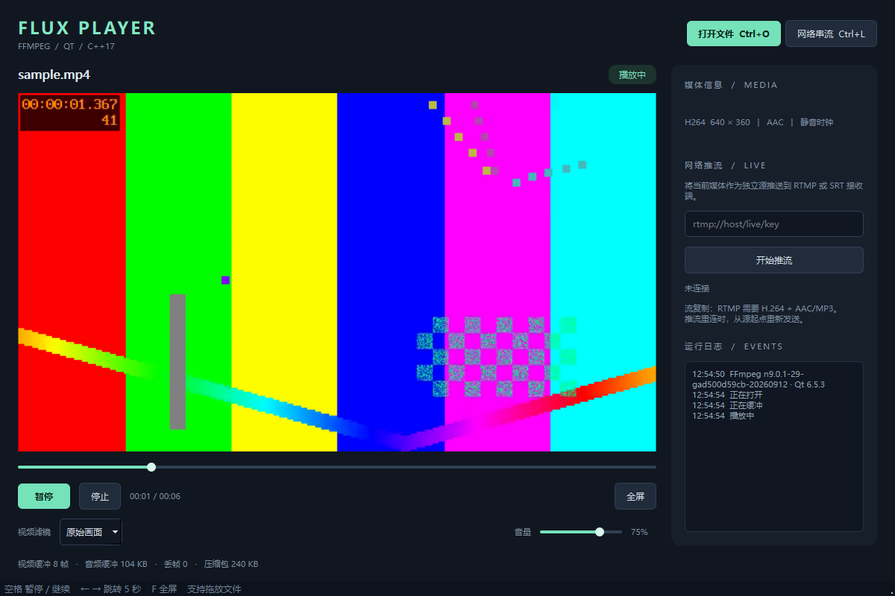

# 本机验证记录

验证日期：2026-10-18。

## 构建环境

- Windows 11 x64，Windows SDK 10.0.19041.0。
- MSVC 19.29.30153（Visual Studio 2019，C++17）。
- Qt 6.5.3，MSVC 2019 x64，Widgets + Multimedia。
- FFmpeg 9.0 系列共享 SDK（libavcodec 63、libavformat 63、libavutil 61）。
- 最终构建使用独立 CMake 3.31.6、Ninja 1.13.2，Release 配置。
- `build-release/FluxPlayer.exe` 编译成功，运行依赖已整理到 `dist/FluxPlayer/`。

## 已通过的检查

| 检查 | 实测结果 |
| --- | --- |
| 多生产者 / 多消费者队列 | 4 个生产者、3 个消费者，4,000 个元素无丢失或重复 |
| 队列容量和字节上限 | 达到上限阻塞，消费后唤醒 |
| 队列结束和取消 | close 排空；abort 清空并唤醒阻塞线程；超时取出正常 |
| 移动所有权 | unique_ptr 能在队列中转移 |
| H.264 + AAC 解码 | 6 秒素材，完整输出 180 帧视频、288,000 个 48 kHz 音频采样帧 |
| 跳转到 2.25 秒 | 输出 113 帧视频，时间戳单调，目标前数据正确丢弃/裁剪 |
| 黑白 / 镜像 / 鲜艳 / 边缘 | 每种滤镜输出 180 帧；黑白滤镜检查 RGB 通道一致性 |
| 纯音频 / 纯视频 | WAV 与 MP4 分别正常解码、排空、结束 |
| 中文与空格路径 | 中文名称的媒体文件正常打开和解码 |
| 错误输入 | 不存在文件返回错误，不崩溃 |
| 停止与取消 | 文件、无数据 UDP、运行中 UDP 可以取消退出 |
| 控制器操作 | 暂停时位置冻结，暂停中跳转到 2 秒，再继续至 EOF |
| 无声卡/静音时钟路径 | 音视频、纯音频、纯视频三种控制器测试通过 |
| HTTP 回环播放 | 完整解码 180 帧与 288,000 个音频采样帧 |
| UDP 回环播放 | MPEG-TS 实际输出 190 帧视频和 276 个音频块，取消后退出 |
| SRT 推流 | 实际发送 440 包、675,239 字节；接收 TS 经 ffprobe 检出 H.264 + AAC |
| RTMP 推流 | 实际发送 440 包、675,239 字节；接收 FLV 经 ffprobe 检出 H.264 + AAC |
| 真实音频输出时钟 | QAudioSink 已启用，暂停/跳转/播完通过；结束位置 6 秒；测试音量为 0 |
| Qt 无窗口测试 | 空闲和实际播放两种启动均正常，截图生成并自动退出 |
| 最终运行包 / 原生 Windows 窗口 | 从 dist/FluxPlayer 启动，空闲/播放两种测试均以 0 退出；中文字体、控件布局、画面截图人工检查正常 |

测试素材由 FFmpeg 的 `testsrc2` 与 440 Hz 正弦波生成，分辨率 640×360、30 fps、H.264 含 B 帧，输入音频采样率 44.1 kHz。素材、抓取结果和日志保存在 `test-media/`、`artifacts/`；这些目录不进入源码版本控制。

## 构建与测试中的环境问题

- 本机旧版 Ninja 使用 ANSI 文件路径 API，无法稳定处理中文目录的增量依赖检查。最终使用独立 CMake/Ninja 和新的构建目录。
- Qt 安装辅助工具在中文目录中更新 qmake 元数据时发生编码错误，但开发库已完整解压，CMake 编译成功。一般部署建议将 Qt SDK 安装在 `C:/Qt` 一类简短英文路径。
- `windeployqt` 默认只部署 `qwindows.dll`；无窗口截图测试另行补入 `qoffscreen.dll`。offscreen 后端不自动使用 Windows 字体，不能用其缺字截图判断原生窗口的字体显示。
- 初始 HTTP 测试使用 1.5 秒期限触发超时；随后改用与播放器一致的 8 秒 I/O 期限，回环验证通过。

## 验证范围

网络测试只在 `127.0.0.1` 回环环境执行。公网抖动、长时间断线重连、TLS 服务器兼容性、RTSP 摄像头、超长媒体和高分辨率长时间压力测试尚未覆盖。Linux/macOS 提供构建配置与说明，未在本机交叉验证。

自动测试不代替主观音质和唇音同步测量；这里验证的是数据完整性、时间戳调度、真实音频设备时钟、操作流程及网络传输。播放器的功能边界见根目录 README。

## 原生窗口截图

